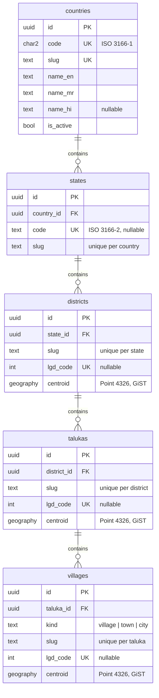

# Data model

Conventions: see [ADR 0003](../architecture/adr/0003-database-conventions-and-regions.md).
Every table has `id uuid` (PK), `created_at`, `updated_at`; names are `name_en` / `name_mr` /
`name_hi`.

## Implemented (Sprint 1): regional hierarchy

All levels except `countries` also have the name columns and `is_active` (omitted above for
brevity). Foreign keys are `ON DELETE RESTRICT`.

Database-level guarantees (tested in `tests/integration/test_regions.py`):

- Slug format `^[a-z0-9]+(-[a-z0-9]+)*$` and uniqueness within the parent.
- Non-blank `name_en` and `name_mr`; `kind` restricted to `village`, `town`, `city`.
- `updated_at` maintained by trigger `set_updated_at()`.
- A parent with children cannot be deleted.
- The app role can read and write rows but cannot change structure.

## Planned entities (by sprint)

| Sprint | Entities                                                                                                   | Notes                                                                                   |
| ------ | ---------------------------------------------------------------------------------------------------------- | --------------------------------------------------------------------------------------- |
| 2      | `users`, `roles`, `permissions`, `user_roles`, `role_scopes`                                               | Scope rows bind District/Taluka admins to regions; enforced in services and queries     |
| 3      | `categories`, `businesses`, `business_contacts`, `business_images`, `business_hours`, `business_locations` | Business location `geography(Point)` + GiST for nearby search; trigram indexes on names |
| 6      | `business_owners`, `business_verifications`, `user_reports`, `audit_logs`                                  | Approval workflow; append-only audit log                                                |
| 5–8    | `reviews`, `saved_businesses`, `business_offers`, `listing_analytics`                                      | Analytics as aggregated daily counters, not raw personal events                         |
| 7–8    | `ai_conversations`, `ai_usage_logs`                                                                        | Model, tokens, latency, cost; retention policy before storing conversation text         |

Privacy by design: store only what a feature needs, with no precise user location history and
no raw IP addresses beyond short-lived rate-limit keys. Retention periods are defined with
each entity.
